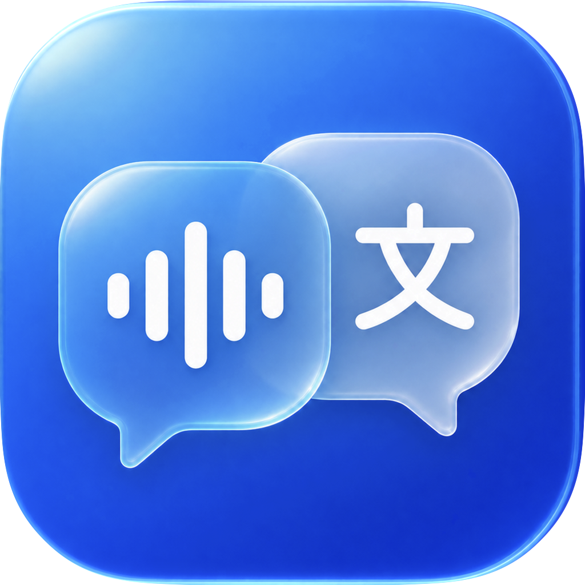
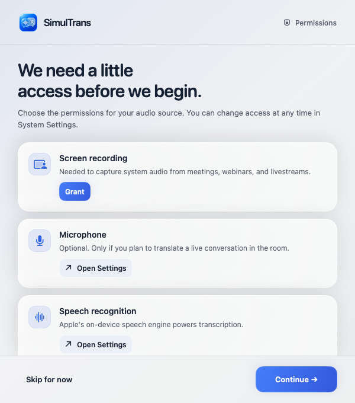
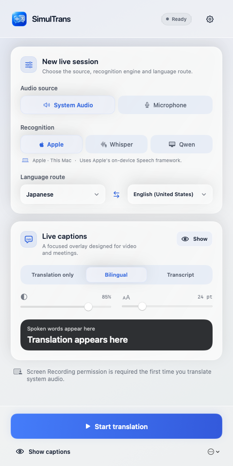
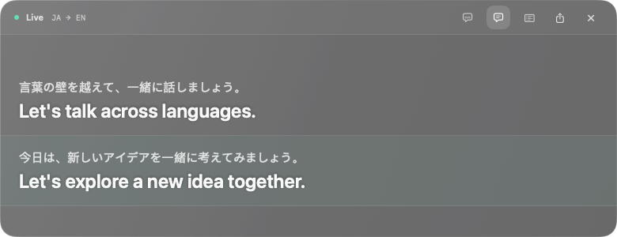
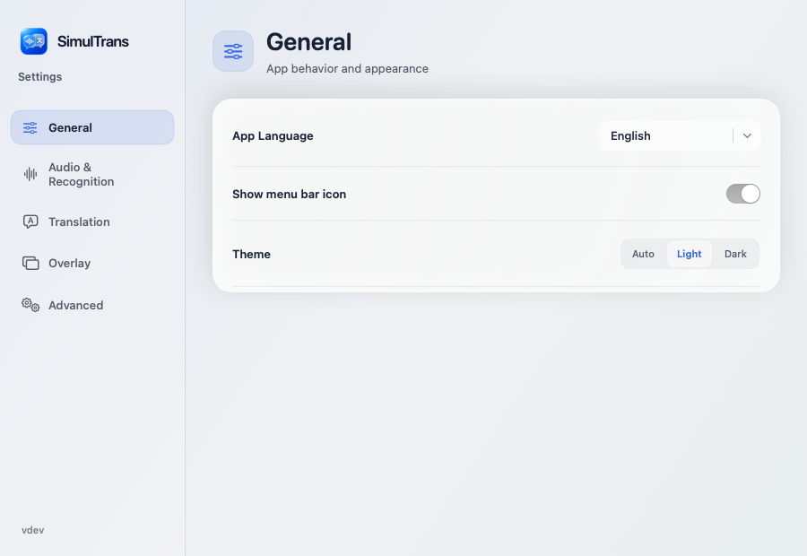

<div align="center">
  
  <h1>SimulTrans</h1>
  <p>Version 1.1.0</p>
  <p><strong>Free, native real-time speech transcription and translation for macOS.</strong></p>
  <p>Listen to system audio or microphone input, transcribe speech, translate it, and keep a bilingual live transcript on screen.</p>
  <p>
    <a href="https://github.com/Macha1234/SimulTrans/releases/latest/download/SimulTrans.dmg"><strong>Download Latest macOS Build</strong></a>
    ·
    <a href="https://github.com/Macha1234/SimulTrans/releases/latest">Latest Release</a>
  </p>
</div>

## Why SimulTrans Exists

Real-time translation tools are often locked behind subscriptions, and many of them are expensive for a workflow that should feel like a small desktop utility.
SimulTrans is built as a practical, local-first alternative for meetings, livestreams, webinars, classes, and everyday listening across languages.

The goal is not to replace professional interpretation. The goal is to make live understanding easier when you just need fast, accessible subtitles and a saved bilingual transcript.

## What It Does

- Captures either system audio or microphone input.
- Transcribes speech using Apple's native speech stack.
- Offers optional `Whisper large-v3-turbo` recognition on this Mac and `Qwen3-ASR-1.7B` through a user-configured Mini PC CUDA service. An optional MLX sidecar also supports Qwen on Apple Silicon.
- Translates recognized text with Apple's `Translation` framework, with optional Context AI refinement through your own Ollama service and Apple translation as the fallback.
- Shows source text and translated text in a floating live overlay.
- Preserves scrollable caption history in every layout, with an always-visible toolbar for layout, export, and visibility controls.
- Uses blue native macOS glass surfaces and SF system typography.
- Supports app display language settings and target-language-specific overlay text.
- Includes onboarding for macOS permissions.
- Provides an optional recognition debug view for comparing raw, processed, and displayed text.
- Exports transcript history as a plain-text file.

## Screenshot Tour

These previews use the current native UI in English, with example text in the live captions.

### First-Run Permission Onboarding

SimulTrans guides the user through the macOS permissions it may need: Screen Recording, Microphone, and Speech Recognition.



### Main Control Window

The compact control window manages input source, speech language, translation target, overlay appearance, start/stop actions, export, history clearing, and optional debugging.



### Floating Live Overlay

The overlay sits above meetings, videos, or livestreams. Translation-only, bilingual, and transcript layouts all preserve scrollable history. Its toolbar stays visible while captions update.



### Settings Window

Secondary preferences live in a dedicated Settings window, including appearance, app language, overlay behavior, export defaults, and Advanced diagnostics for comparing raw, processed, and displayed recognition text.



## How Recognition Works

SimulTrans is intentionally built around Apple's native macOS frameworks instead of paid third-party speech or translation APIs.

- It prefers Apple's modern speech transcription pipeline when available.
- It falls back to the classic `SFSpeechRecognizer` path where needed.
- It can switch to Whisper on this Mac or Qwen through the configured ASR service.
- It keeps a short rolling audio prebuffer to reduce missed words when recognition restarts between utterances.
- It treats in-progress speech as a live row, then commits stable speech into transcript history.
- It allows translations to update while avoiding destructive overwrites of the original recognized source text.

Recognition quality still depends on macOS language assets, source audio quality, background noise, and the language pair being used.

### Optional Recognition And Context AI

Model runtimes and model files are not bundled with the app.

| Engine | Processing location | Endpoint |
|---|---|---|
| `Apple Speech` | This Mac, using Apple's speech framework | n/a |
| `Whisper large-v3-turbo` | This Mac, using `whisper.cpp` | `http://127.0.0.1:2022/v1/audio/transcriptions` |
| `Qwen3-ASR-1.7B` | Your configured Mini PC CUDA service through an SSH tunnel | `http://127.0.0.1:8765/v1/audio/transcriptions` |

For Qwen, configure your own SSH host and forward its ASR port. The app uses
`SIMULTRANS_QWEN_SSH_HOST` for remote service control; the default SSH alias is
`minipc`. A generic tunnel example is:

```bash
ssh -N -L 8765:127.0.0.1:8765 your-server
SIMULTRANS_QWEN_SSH_HOST=your-server ./build_and_run.sh
```

The `scripts/` directory also provides an optional local MLX Qwen sidecar for
Apple Silicon. Install local dependencies with
`./scripts/install_local_asr.sh whisper` or `./scripts/install_local_asr.sh qwen`.
For custom runtime locations:

```bash
SIMULTRANS_WHISPER_SERVER=/path/to/whisper-server \
SIMULTRANS_WHISPER_MODEL=/path/to/ggml-large-v3-turbo.bin \
SIMULTRANS_QWEN3_ASR_PYTHON=/path/to/python3 \
SIMULTRANS_QWEN3_ASR_SIDECAR=/path/to/qwen3_asr_server.py \
./build_and_run.sh
```

Optional Context AI sends recognized text and translation context to your own
Ollama service through `http://127.0.0.1:11435` for a final refinement pass.
Apple Translation supplies the initial result and remains the fallback when
refinement is unavailable. A loopback endpoint can forward to another machine:
Qwen audio and Context AI text may leave this Mac for your configured services.

Recognition segments audio into temporary 16 kHz WAV files for the selected
ASR endpoint. Translation consumes finalized recognition text independently.

## Download And Install

1. Download `SimulTrans.dmg` from the latest release:

```text
https://github.com/Macha1234/SimulTrans/releases/latest/download/SimulTrans.dmg
```

2. Open the DMG.
3. Drag `SimulTrans.app` into `Applications`.
4. Launch SimulTrans from `Applications`.
5. If macOS blocks the first launch because the app is distributed outside the App Store, right-click the app and choose `Open`, or open `System Settings > Privacy & Security` and choose `Open Anyway`.
6. Grant the requested permissions when prompted.

Current release builds are distributed outside the Mac App Store and are not notarized, so the first launch may include an extra Gatekeeper confirmation step.

## Typical Use Cases

- Following overseas livestreams with translated subtitles.
- Watching webinars or presentations in another language.
- Listening to meetings while keeping a bilingual running transcript.
- Saving useful spoken content with both source text and translated text.
- Debugging recognition behavior with raw recognizer output visible.

## Requirements

- macOS 15 or later.
- Screen Recording permission for system audio capture.
- Microphone permission for microphone mode.
- Speech Recognition permission for transcription.
- Apple speech and translation assets for the languages you want to use.
- Optional dependencies for your selected ASR backend: `cmake` and `whisper.cpp` for local Whisper; a configured CUDA service for remote Qwen; or Python 3.10+ and `mlx-qwen3-asr` for the optional local Qwen sidecar.
- Xcode 16 / Swift 6 for building the app.
- Xcode 26 or later with Icon Composer support to regenerate the native icon assets; app builds use the checked-in assets.

## Development

Build the Swift package:

```bash
swift build
```

Build, sign, install, and launch the app locally:

```bash
./build_and_run.sh
```

By default, `build_and_run.sh` installs the app to:

```text
/Applications/SimulTrans.app
```

The script creates a temporary bundle at `dist/SimulTrans.app` while building, then removes it after installation so your Mac only keeps one active app copy. If you intentionally want to keep the temporary bundle for inspection, run:

```bash
KEEP_DIST_APP=1 ./build_and_run.sh
```

Use your own signing identity if needed:

```bash
SIGNING_ID="Apple Development: Your Name" ./build_and_run.sh
```

If no signing identity is available, the script falls back to ad-hoc signing.

## Packaging A DMG

Create a release DMG:

```bash
./package.sh
```

Override the version if needed:

```bash
VERSION=1.1.0 ./package.sh
```

Release artifacts are written to `dist/`.

## Publishing A Release

For maintainers, publishing a downloadable GitHub release is:

```bash
git tag v1.1.0
git push origin v1.1.0
```

Pushing a `v*` tag triggers the GitHub Actions release workflow. The workflow builds the app on macOS, packages the DMG, generates SHA-256 checksum files, and uploads the assets to GitHub Releases.

## Project Structure

```text
.
├── AppTemplate/        # Template app bundle used for packaging
├── Sources/            # Main app source code and localized resources
├── Tests/              # Caption and recognition behavior tests
├── scripts/            # Optional local ASR setup and MLX sidecar
├── docs/               # Product and design-system documentation
├── assets/             # App icon and README screenshots
├── build_and_run.sh    # Build, sign, install, and launch locally
├── package.sh          # Release build and DMG packaging
├── generate_icon.py    # Generates AppIconGlass.icns and Assets.car
└── debug_ax.swift      # Optional accessibility/debug helper
```

## Tech Stack

- Swift Package Manager
- AppKit + SwiftUI
- `Speech`
- `ScreenCaptureKit`
- `Translation`
- Optional local ASR:
  - `whisper.cpp`
  - `mlx-qwen3-asr`
  - SimulTrans Qwen sidecar

## Notes

- The app UI can follow the system language or use a manually selected display language.
- The translation overlay follows the selected target language for status text.
- The native `assets/logo/AppIconGlass.icon` source generates `AppIconGlass.icns` and `Assets.car`. The native icon stack avoids an extra gray frame around the artwork on macOS.
- `debug_ax.swift` is a helper script and is not required for normal usage.
- Build artifacts, DMGs, and temporary outputs are excluded from git.
